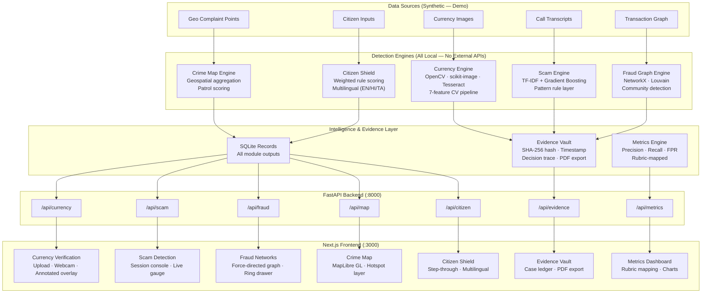

# PRAHARI — System Architecture

> Point-of-contact threat detection — stopping fraud at the point of contact, not the point of complaint.

## System Diagram

## Component Index

| Component | Technology | Purpose |
|-----------|-----------|---------|
| Currency Engine | OpenCV, scikit-image, Tesseract | 7-feature note authentication |
| Scam Engine | scikit-learn GBM, TF-IDF, regex patterns | Digital-arrest session classification |
| Fraud Graph | NetworkX, python-louvain | Community detection on transaction graph |
| Crime Map | FastAPI, GeoJSON | Spatial aggregation and patrol scoring |
| Citizen Shield | Weighted rule scoring | Guided risk check (3 languages) |
| Evidence Vault | SQLite, fpdf2 | Auditable record with SHA-256 chain |
| Backend | FastAPI, Pydantic v2, Uvicorn | REST API, async, auto-docs |
| Frontend | Next.js 14, TypeScript, Tailwind | Command-centre UI |
| Orchestration | docker-compose, Makefile | One-command startup |

## Key Design Decisions

- **No external API calls** — every detection runs locally. Zero egress, works air-gapped.
- **Classical CV, not black-box** — each currency check is individually explainable with a region bbox, confidence, and plain-language detail.
- **Evidence-first** — every verdict writes a content-hashed, timestamped, engine-versioned record before surfacing to the UI.
- **Deterministic citizen tool** — Citizen Shield uses weighted rule scoring, not a chatbot; every output has an auditable reason list.
